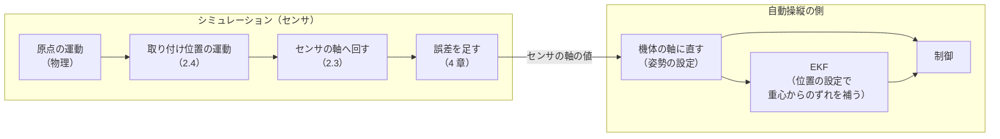

# センサの共通仕様（取り付け位置姿勢・処理の順番・自動操縦との合わせ方）

箱庭ドローンのセンサ（加速度・ジャイロ・地磁気・気圧・GPS・ESC テレメトリ）に共通する決まりを書きます。
センサごとの README には、そのセンサに固有のことだけを書きます。

- この文書が正本です。drone_config の設定の決まり（スキーマ）は、この文書に合わせます。
- スキーマは `schema/sensors.schema.json`（`components.sensors`、センサー v2）。項目をまたぐ決まりは `tools/check_sensors_config.py`、読み込みそのものの判定は `hakoniwa-check-sensors-config`（`HAKO_ENABLE_SENSOR_MODEL_V2=ON` のビルド）。両者の一致は `tools/tests/test_check_sensors_config.py` が確かめます。

## 1. 座標と単位

| 対象 | 軸 | 単位 |
|---|---|---|
| 世界 | NED（北・東・下） | m |
| 機体 | FRD（前・右・下） | m |
| 角度 | ロール・ピッチ・ヨー | drone_config では度 |
| 角速度 | 機体の軸 | rad/s `[SEN-COM-010]` |

軸の対応（MuJoCo の FLU との変換など）は [座標系統合メモ](../coordinate-system-integration.md) にあります。

### 1.1 前提：物理計算は MuJoCo

この仕様は、機体の物理計算に MuJoCo を使う場合（drone_config の `components.droneDynamics` が MuJoCo）を前提にします。
センサの真値（位置・速度・加速度・角速度・角加速度）は、MuJoCo の機体の本体から取ります。 `[SEN-COM-020]`

### 1.2 機体の原点と重心

**機体の原点**は、機体座標系の原点です。具体的には、MuJoCo のモデル（MJCF）で機体の本体を表す body `[SEN-COM-030]`
（free joint を持つ body）の原点で、モデルを作った人が置いた点です。多くのモデルでは機体の真ん中あたりにあります。
drone_config のローター位置（`rotorPositions`）も、この原点から測った値です。

| | 機体の原点 | 重心 |
|---|---|---|
| 決まり方 | モデル（MJCF）に固定 | MuJoCo が、積んだ物も含めて計算 |
| 荷物・電池を積み替えたとき | 動かない | 動く |
| この仕様での使い方 | 人が書く位置の基準。センサの値の計算の基準 | 自動操縦に渡す位置の設定値を作るときだけ（5 章） |

荷物を積まず、機体が前後左右に対称なら、原点と重心はほぼ同じ場所になります。
違いが出るのは、荷物を積んだときや、偏った機体を作ったときです。

## 2. 取り付け位置姿勢（mounting pose）

### 2.1 書き方

センサが機体のどこに、どの向きで付いているかを、**取り付け位置姿勢**（mounting pose）と呼びます。
取り付け位置姿勢は、次の 2 つでできています。書き方は全センサで同じです。 `[SEN-COM-040]`

- **位置**：機体の原点から見たセンサの位置
- **姿勢**：機体の軸に対するセンサの軸の傾き

```json
"mount": {
  "positionM": [0.05, 0.0, -0.02],
  "orientationDeg": { "roll": 0.0, "pitch": 0.0, "yaw": 90.0 }
}
```

| 項目 | 意味 | 省略したとき |
|---|---|---|
| `positionM` | 機体の原点から見たセンサの位置。FRD、m | `[0, 0, 0]` |
| `orientationDeg` | 機体の軸に対するセンサの軸の傾き。度 | すべて 0 |

`mount` を書かなければ、センサは機体の原点に、機体と同じ向きで付いているものとします（既定値）。 `[SEN-COM-050]`

位置を重心からではなく原点から書くのは、荷物で重心が動いても書き直さずに済むようにするためです。
重心から見た位置が要る場面（自動操縦の設定）では、5 章のとおりシミュレーションの側で計算します。

### 2.2 IMU はひとまとめに書く

加速度とジャイロは、実機では同じ IMU のチップに入っていて、同じ位置・姿勢で付いています。
地磁気センサも、IMU と同じ基板（フライトコントローラの基板）に載っているもの（内蔵）とします。
自動操縦の設定（PX4 の `SENS_BOARD_ROT`、ArduPilot の `AHRS_ORIENTATION`）も、この 3 つに同時に効きます。
そのため、取り付け位置姿勢は IMU として 1 つだけ書きます。

| 書く場所 | 効くセンサ |
|---|---|
| `components.sensors.imu.mount` | 加速度とジャイロと地磁気（地磁気は姿勢だけを使う） `[SEN-COM-060]` |
| `components.sensors.baro.mount` | 気圧 |
| `components.sensors.gps.mount` | GPS |

`acc`、`gyro`、`mag` には `mount` を書きません（書いたらエラーにします）。 `[SEN-COM-070]`

### 2.3 回転の式

`orientationDeg` から、センサの軸を機体の軸で表す回転行列 R を作ります。回す順番はヨー → ピッチ → ロールです。 `[SEN-COM-080]`

```text
R = Rz(yaw) · Ry(pitch) · Rx(roll)
```

ベクトル（角速度、加速度、地磁気）の変換は、次のとおりです。 `[SEN-COM-090]`

```text
センサの軸での値  v_sensor = Rᵀ · v_body
機体の軸に戻す    v_body   = R  · v_sensor
```

- 例：`yaw = 90` で付けたセンサの x 軸は、機体の右（+y）を向きます。機体が前（+x）へ加速すると、センサには −y 方向の加速度として出ます。
- この式は全センサで 1 つの関数として実装し、テストも 1 か所で管理します。 `[SEN-COM-100]`
- PX4・ArduPilot に同じ角度を設定すると R で戻せる（v_body に戻る）ことを、テストで確かめます。

### 2.4 位置の効き方

機体の原点の動きから、原点から r = `positionM` だけ離れた点の動きを、剛体の運動の式で計算します。記号と座標は次のとおりです。 `[SEN-COM-110]`

| 記号 | 意味 | 座標 |
|---|---|---|
| p、v | 機体の原点の位置・速度 | 世界（NED） |
| a | 機体の原点の並進加速度（MuJoCo の機体の本体の原点の加速度。重心の加速度ではない） | 機体（FRD） |
| ω、α | 機体の角速度・角加速度 | 機体（FRD） |
| r | 原点から見たセンサの位置（`positionM`） | 機体（FRD） |
| R_nb | 機体の軸 → 世界の軸の回転 | — |

a が原点の加速度なので、この計算に重心は使いません。

| 量 | センサの位置での値 |
|---|---|
| 位置（世界） | p + R_nb · r |
| 速度（世界） | v + R_nb · (ω × r) |
| 加速度（機体） | a + α × r + ω × (ω × r) |

- ω × (ω × r) は中心へ向かう加速度です。例：r = 5 cm、300°/s で約 1.4 m/s²。
- α × r は、回転が速まる・遅くなるときの加速度です。

## 3. センサごとに使うもの

| センサ | 位置 | 姿勢 | 位置で変わるもの `[SEN-COM-120]` |
|---|---|---|---|
| ジャイロ | 使わない | 使う | なし（剛体では角速度はどこでも同じ） |
| 加速度 | 使う | 使う | 中心へ向かう加速度と、回転が速まる・遅くなるときの加速度 |
| 地磁気 | 使わない | 使う | なし（地磁気は機体の大きさでは変わらない） |
| 気圧 | 使う（高さだけ） | 使わない | 測る高さ |
| GPS | 使う | 使わない | 測る位置と速度 |
| ESC テレメトリ | 使わない | 使わない | なし |

## 4. 処理の順番

どのセンサも、次の段をこの順番で通ります（共通の段の相対的な順番）。センサに固有の段（ジャイロの目盛りの誤差など）は、センサごとの仕様でどこに入るかを決めます。 `[SEN-COM-130]`

```text
真値（MuJoCo） → 取り付け位置姿勢（位置 → 姿勢） → 遅れ → 測る → ノイズ → ドリフト → 頭打ち → 出力
```

- **値は、測る周期の境目でだけ新しく作ります。**その間は同じ値を出し続けます。制御もログも、同じその値を読みます。ログには、制御が実際に受け取った値が残ります。 `[SEN-COM-140]`
- Gazebo・AirSim と同じ考え方です。既定では、センサの中で値をならす（ローパスフィルタ）ことはしません。加速度・ジャイロだけは、明示的に有効にしたときに、IMU のフィルタをかけられます（4.5）。
- **取り付け位置姿勢は一番最初**です。ノイズ・ドリフト・頭打ちは、センサの軸に乗る誤差だからです。 `[SEN-COM-150]`
- 特に頭打ち（測れる範囲）は、センサの軸ごとに起きます。斜めに付けたジャイロは、機体の軸で見ると別の回り方で振り切れます。

各段の意味は次のとおりです。設定の名前と細かい決まりは、センサごとの仕様にあります。

| 段 | 意味 |
|---|---|
| 遅れ | センサの値そのものが遅れる（ハードの遅れ）。物理の刻みの整数倍に、四捨五入で丸める。遅れの分の履歴がたまるまでは、最初の入力値を出す `[SEN-COM-160]` |
| 測る | `updatePeriodMsec` の境目（シミュレーションの時刻 0、T、2T、…）で、遅れのあとの値を 1 回測る。`updatePeriodMsec` を書かなければ物理の刻みごと `[SEN-COM-175]`。`updatePeriodMsec` は物理の刻みの整数倍で書く。割り切れないときは、最も近い整数倍（最低 1 刻み）に丸めて測り、丸めた周期を警告で知らせる。割り切れる物理の刻みを選ぶ（例：400 Hz（2.5 ms）なら 0.5 ms の刻み） `[SEN-COM-177]` |
| ノイズ | 正規分布のゆらぎ（平均 0）を、測った値ごと・軸ごとに別々に 1 回足す。標準偏差は 1 つの値（3 軸共通）か、軸ごとの [x, y, z] で書く `[SEN-COM-180]` |
| ドリフト | ゼロ点のゆっくりした変化。どのセンサでも共通に使う形は 4.2 の Gauss-Markov |
| 頭打ち | 測れる範囲を超えた値を、範囲の端で切る `[SEN-COM-190]` |

センサの値とは別に、渡し方の設定が 2 つあります。

| 設定 | 意味 |
|---|---|
| `softDelayMsec` | 自動操縦が値を受け取ってから使うまでの遅れ（ソフトの遅れ） `[SEN-COM-200]` |
| `updatePeriodMsec` | センサが新しい値を測って出す周期。自動操縦が値を読む周期にもなる `[SEN-COM-210]` |

### 4.0 設定の省略と誤り

どのセンサにも、次の決まりを当てます。センサごとの仕様に別の決まりがあれば、そちらに従います。
型の違う値（数の欄に文字列・配列・オブジェクトなど）は、どの設定でも読み込みをエラーにします。 `[SEN-COM-215]`

| 設定 | 省略したとき | 誤りとして読み込みをエラーにするとき |
|---|---|---|
| ノイズの σ | ノイズなし | 有限でない。値が 1 つしかない量（気圧など）に [x, y, z] を書いた `[SEN-COM-211]` |
| ノイズの σ が 0 以下 | — | （エラーにしない。その軸・値はノイズなし） `[SEN-COM-211]` |
| 分解能 | 丸めない | 0 以下、有限でない `[SEN-COM-212]` |
| 頭打ち（`range` の欄ごと） | その欄で切らない | 0 以下（最小・最大で書くものは最小 ≥ 最大）、有限でない `[SEN-COM-213]` |
| ゼロ点のずれ | ずれなし | 決まったずれと起動時に引くずれを両方書いた。有限でない `[SEN-COM-214]` |
| ドリフト | ドリフトなし | そのセンサの仕様にない `mode`。σ が負、`correlationTimeSec` が 0 以下、有限でない `[SEN-COM-218]` |
| 取り付け位置姿勢 | 原点・同じ向き（2.1） | 要素の数・型の誤り、有限でない、書いてはいけないセンサに書いた（2.2） `[SEN-COM-219]` |

- 知らない設定の名前は、エラーにせず警告を出します（お客様の独自の項目や、古い項目で止めないため）。 `[SEN-COM-216]`
- シミュレーションで使う値と別の値を自動操縦の設定にするとき、変換できない違い（例：ArduPilot SITL で置き換えられない項目）は、設定を作る道具が記録に残します。 `[SEN-COM-217]`

### 4.1 乱数とリセット

- 乱数を使う特性（ノイズ、起動時に引くずれ、酔歩・Gauss-Markov のドリフトなど）は、それぞれ別の乱数の列を使います。 `[SEN-COM-220]`
  列の種は、`simulation.randomSeed`、機体の名前、機体の番号、センサの名前、特性の名前から作ります。
  同じ設定と同じ種なら、同じ値の並びになります。種がなければ、毎回違う並びになります。
- シミュレーションをリセットすると、遅れの履歴、測った値と周期の境目、ドリフトの時刻と状態、起動時に引くずれ、乱数の列を、 `[SEN-COM-230]`
  すべて始めの状態に戻します。同じ種なら、リセットのあとも同じ値の並びになります。
- 新しいセンサモデルでは、同じ種でも乱数の並びは旧方式と異なります。乱数の分布は同じです。

### 4.2 ゆっくり変わるずれ（Gauss-Markov）

ゼロ点のずれが、時間とともにゆっくり動く性質です。酔歩と違い、ずれの分散は時間がたっても一定の大きさ（σ²）に保たれます（値がある範囲を超えないことを保証するものではありません）。実機のセンサのずれ（bias instability）に近い形です。
ジャイロ・加速度・地磁気・気圧・GPS で同じ形を使います（`drift.mode` が `gauss-markov`）。 `[SEN-COM-240]`

```text
φ   = exp(−Δt / τ)
σ_d = σ · √(1 − exp(−2Δt / τ))
b_k = φ · b_(k−1) + N(0, σ_d²)       （軸ごとに別々）
```

| 記号 | 意味 |
|---|---|
| σ | ずれの大きさ（標準偏差）。単位はセンサごとの仕様 |
| τ | 相関時間（`correlationTimeSec`、秒）。ずれが変わる速さの目安。長いほどゆっくり |
| Δt | 測る周期（`updatePeriodMsec`、なければ物理の刻み）。ドリフトは測るたびに 1 回進める |

- 始めの値 b_0 は、軸ごとに N(0, σ²) から引きます。始めから、ずれの大きさが一定の状態です。 `[SEN-COM-250]`
- 起動時のゼロ点のずれ（固定のずれ）とは別に足します。固定のずれは飛行中も変わりません。 `[SEN-COM-260]`
- SDFormat（Gazebo）の dynamic bias と同じ一次の Gauss-Markov 過程です。ただし設定する値の意味が違います。
  箱庭の σ は「ずれそのものの大きさ（定常の標準偏差）」、SDFormat の `dynamic_bias_stddev` は「ずれを動かすノイズの標準偏差」です。
  SDFormat に直すときは `dynamic_bias_stddev = σ · √(2 / τ)` です（7 章）。 `[SEN-COM-370]`

### 4.3 ノイズを密度で書く

ノイズは、ノイズの密度（`noiseDensity`）か、1 つの値ごとの標準偏差 σ（`noise`）で書きます。**密度で書くことを勧めます。** `[SEN-COM-185]`

- 1 つの値ごとの σ は、自動操縦が値を読む周期で変わります。速く読むほど、1 回ごとのばらつきは大きくなります。
  σ で書くと、読む周期を変えたときに σ も書き直す必要があります。
- 密度は、読む周期によらないノイズの大きさです。データシートの値（ジャイロの角度ランダムウォーク、加速度の速度ランダムウォーク、
  ノイズ密度）をそのまま書けます。σ には、読み込むときに箱庭が直します。
- σ の書き方は、飛行のログから測ったばらつきや、σ で書かれた既存の設定・他のシミュレータの設定を、そのまま使うために残します。

```text
σ = noiseDensity / √Δt_s
```

| 記号 | 意味 |
|---|---|
| `noiseDensity` | 白色ノイズの密度。単位は「`noise` の単位 / √Hz」（ジャイロ rad/s/√Hz、加速度 m/s²/√Hz、地磁気 nT/√Hz、気圧 m/√Hz） |
| Δt_s | 自動操縦が値を読む周期（秒）。そのセンサの `updatePeriodMsec` |

- `noiseDensity` を書くときは、そのセンサの `updatePeriodMsec` も書きます。書かなければ読み込みをエラーにします。 `[SEN-COM-188]`
  物理の刻みで直すと、自動操縦が物理の刻みより長い周期で読むとき、σ が大きすぎるためです（例：物理 1 ms・読む周期 4 ms なら 2 倍）。
- この換算は、理想的な白色ノイズを、自動操縦が値を読む周期で区切ったものとして扱います。実物のセンサの出力のノイズは、中のフィルタや帯域、デジタルの処理でも変わるので、データシートの密度を書けば実物と同じばらつきの性質になる、とは言えません。実物に合わせるときは、実物のログのばらつき（σ）や、アラン分散・自己相関と比べて決めます。
- 読み込むときに 1 回だけ σ に直します。そのあとは、σ を `noise` に直接書いたときと同じに動きます（同じ種なら同じ値の並び）。 `[SEN-COM-186]`
- 書き方は `noise` と同じです（1 つの値か [x, y, z]。値が 1 つの量は 1 つの値だけ。0 以下の軸はノイズなし）。
- `noise` と `noiseDensity` を両方書いたら、読み込みをエラーにします。 `[SEN-COM-187]`
- 使えるのはジャイロ・加速度・地磁気・気圧です。GPS の誤差は値ごとに独立な白色ノイズではないので、GPS には書けません（書いたらエラー）。
- データシートの単位からの直し方の例：ジャイロの角度ランダムウォーク ARW（°/√h）は `noiseDensity` = ARW × (π/180) / 60（rad/s/√Hz）。
  加速度の速度ランダムウォーク VRW（m/s/√h）は `noiseDensity` = VRW / 60（m/s²/√Hz）。

### 4.4 ロータ由来の振動（実験的なオプション）

加速度・ジャイロに、**IMU の取り付け点での周期的な観測外乱**を、[プロペラの振動の生成器](vibration/README.md)から足せます。5 つのセンサの仕様は変えない、実験的なオプションです。

- 振動生成器はローターの**実**角速度を入力とし、加速度 [m/s²] と角速度 [rad/s] のFRDベクトルを返します。機体ごとに1つ、物理刻みごとに1回だけ更新し、加速度・ジャイロは同じ時刻の値を共有します。
- 加速度は剛体の `α×r + ω×(ω×r)` を**真の角速度・角加速度だけで計算した後**、振動加速度を足します。ジャイロは真の角速度に振動角速度を足します。いずれもIMUの姿勢・感度・遅れ・測定周期・ノイズ・分解能・頭打ちに入る前で合成します。
- 無効な構成では生成器を作らず、既存センサーV2の出力・乱数列を変えません。生成器がMuJoCoの機体の物理状態を変えることはありません。
- 生成器は生の振動を作るだけです。高調波を遅い周期で読むときの折り返しは、IMU のフィルタ（4.5）で、測る前に防ぎます（振動の仕様 5 章）。
- 設定は `components.propellerVibration` で、`components.sensors` とは別です。

受け入れ条件の詳細は[振動モデルのテスト設計](vibration/test-design.md)を参照してください。

### 4.5 IMU のフィルタ（オプション）

実機の IMU のチップは、測った値を中でならして（ローパスフィルタ）から出します。加速度とジャイロには、これを表す**IMU のフィルタ**を、明示的に有効にしたときだけかけられます。既定ではかけません。 `[SEN-COM-460]`

```text
（加速度）f_origin → 位置 → 姿勢 → 目盛り・軸の干渉 → IMU のフィルタ → 遅れ → 測る → ゼロ点のずれ → ノイズ → ドリフト → 分解能 → 頭打ち
（ジャイロ）ω_body → 姿勢 → 目盛り・軸の干渉 → IMU のフィルタ → 遅れ → 測る → ゼロ点のずれ → ノイズ → ドリフト → 分解能 → 頭打ち
```

- フィルタは、センサの軸で、物理の刻みごとに更新し、遅れ・測るより**前**にかけます。測る周期（たとえば 4 ms）で取る前に、高い周波数を弱めます。ロータ由来の振動（4.4）を有効にしたときは、真値と振動を合わせた値にかかります。 `[SEN-COM-462]`
- 加速度（`components.sensors.acc.filter`）とジャイロ（`components.sensors.gyro.filter`）で、別々に設定します。振動の生成器がなくても使えます。 `[SEN-COM-464]`
- フィルタは真値にもかかるので、制御が受け取る値の振幅と位相（遅れ）が変わります。これはシミュレーションすべき IMU の特性として扱います。有効にした機体は、PID の調整と照合をやり直します。 `[SEN-COM-466]`
- 二重に数えないこと：`delayMsec`（ハードの遅れ）には、フィルタの遅れを含めません（データシートの遅れがフィルタ込みなら、その分を引きます）。自動操縦のソフトのフィルタ（PX4 の `IMU_GYRO_CUTOFF`・`IMU_ACCEL_CUTOFF`、ArduPilot の `INS_GYRO_FILTER`・`INS_ACCEL_FILTER`）は、自動操縦の側の別のフィルタです。同じものを両方で表さないでください。 `[SEN-COM-468]`
- ノイズ・ドリフト・ゼロ点のずれは、測ったあとに足します。つまり、ノイズの大きさは IMU が出す値（フィルタのあと）として書きます（4.3 と同じ考え方）。
- 加速度・ジャイロのフィルタを書かなければ（振動の生成器もなければ）、出力はこれまでの v2 とビット単位で同じです。`sampleCount` は、これまでどおり 1 だけ書けます。 `[SEN-COM-470]`

| `filter` の設定 | 決まり |
|---|---|
| `type` | `"chebyshev2"`（Chebyshev II 型：通過域が平らで、阻止域の端より上はどこも決めた減衰以上）か `"butterworth"`（Butterworth 型：通過域も阻止域も単調） |
| `order` | 2 以上の偶数 |
| `stopbandHz`・`stopbandAttenuationDb` | `chebyshev2` のとき必須。阻止域の端（Hz）と、そこから上の減衰（dB、正の数） |
| `cutoffHz` | `butterworth` のとき必須。−3 dB の周波数（Hz） |

周波数は、物理の刻みのナイキスト周波数より下でなければなりません。足りない・誤った値、未知の設定は、読み込みのエラーです。係数は、設定から起動時に計算します（アナログの原型 → 周波数の事前の補正 → 双一次変換 → 2 次の段の直列）。

## 5. 自動操縦との合わせ方

センサをずらして付けたら、自動操縦にも同じ取り付け位置姿勢を設定します。

- **姿勢**：合わせれば、機体と同じ向きに付けたときと同じように飛びます。 `[SEN-COM-270]`
- **位置**：合わせても、加速度の値そのものは原点に付けたときと同じにはなりません（自動操縦は、中心へ向かう加速度などを加速度の値から差し引かないため。加速度センサの仕様 4.1）。合わせれば、原点に付けたときとほぼ同じように飛びます。 `[SEN-COM-280]`

これが、取り付け位置姿勢の受け入れの条件です。

### 5.1 設定の対応

| 取り付け位置姿勢 | PX4 | ArduPilot |
|---|---|---|
| IMU の姿勢（地磁気も含む） | `SENS_BOARD_ROT` と `SENS_BOARD_X/Y/Z_OFF` | `AHRS_ORIENTATION`、`CUST_ROT_ENABLE`、`CUST_ROT1_ROLL/PITCH/YAW` |
| IMU の位置 | `EKF2_IMU_POS_X/Y/Z` | `INS_POS1_X/Y/Z` |
| GPS の位置 | `SENS_GPS0_OFFX/OFFY/OFFZ` | `GPS1_POS_X/Y/Z` |
| 気圧の位置 | なし | なし |

- 自動操縦の位置の設定は**重心から**測ります。シミュレーションの側で「`positionM` − 重心（MuJoCo の機体の重心、機体の原点から見た値）」を計算して渡します。 `[SEN-COM-290]`
  ユーザが自動操縦の値を自分で計算する必要はありません。
- 自動操縦が推定して出す位置・速度は、位置を測る基準の点、つまり**重心**の値です。IMU の付いている点の値ではありません。 `[SEN-COM-295]`
  自動操縦は IMU の位置を使って、IMU で測った動きを重心の動きに直します。
  止まっている機体では、IMU の位置の設定は推定の値に表れません。回る動き（向きを変える・傾く）のときに、遠心の加速度と回る速さの分の違いとして表れます。
  IMU の位置の試験は、回る動きを入れて確かめます。
- 渡し先は、Control Link ではアダプターが読むパラメータ、SITL では SITL を起動するときのパラメータです。 `[SEN-COM-300]`
  取り付けの形の値（姿勢・位置・地磁気の較正）は、PID の自動調整の作業用の設定を作るときに、drone_config の取り付けから 1 回だけ作ります。
  自動調整・Control Link・SITL は、同じその値を使います。取り付けを書き直したときは、自動調整からやり直します（設定を作る道具は、取り付けが変わったことを警告します）。
  自動操縦の推定の見込み（ノイズ・遅れ）は、自動調整の前に機体ごとに決めます。自動調整が決めるのは PID だけです。
- 姿勢の設定は、5.2 の決まりで作ります。

**計算の例（IMU の位置を PX4 へ渡す）**

| 手順 | 値（FRD、m） |
|---|---|
| 1. ユーザが drone_config に書く IMU の位置（原点から） | `imu.mount.positionM = [0.05, 0.00, 0.00]`（前に 5 cm） |
| 2. MuJoCo が計算した重心（原点から） | `[0.01, 0.00, 0.02]`（前に 1 cm、下に 2 cm） |
| 3. 重心から見た IMU の位置（1 − 2） | `[0.04, 0.00, -0.02]` |
| 4. PX4 へ渡すパラメータ | `EKF2_IMU_POS_X = 0.04`、`EKF2_IMU_POS_Y = 0.00`、`EKF2_IMU_POS_Z = -0.02` |

ArduPilot なら、4 の値を `INS_POS1_X/Y/Z` に入れます。GPS も同じ計算で `SENS_GPS0_OFF*`・`GPS1_POS_*` を作ります。
荷物や電池を積み替えて重心が動いたときは、2 が変わるので、渡す値も自動で変わります（ユーザが書いた 1 は変わりません）。

### 5.2 姿勢の設定の作り方

取り付け位置姿勢の回転行列 R（2.3）から、自動操縦の姿勢の設定を次のように作ります。

どちらの自動操縦も、姿勢の設定は角度ではなく、回転の**番号**です（単位はありません）。
実機では基板を 45° きざみ（90°、180° など）で回して付けることがほとんどなので、その決まった回転が番号の表になっています。
番号で表せる姿勢なら、その番号を使うのが基本です。表せない細かい角度の扱いは、自動操縦ごとに違います。

| | 番号の表 | 表にない角度 |
|---|---|---|
| PX4 | `SENS_BOARD_ROT` | 近い番号を選び、残りの角度（度）を `SENS_BOARD_X/Y/Z_OFF` で足す。任意の角度を表す番号はない |
| ArduPilot | `AHRS_ORIENTATION`（地磁気の `COMPASS_ORIENT` も同じ表。ArduPilot SITL では、地磁気に取り付けの逆の回転を書く。地磁気の仕様 5.3） | 特別な番号 101（Custom 1）を選び、角度（度）は別の設定 `CUST_ROT1_ROLL`・`PITCH`・`YAW` に書く。`CUST_ROT_ENABLE = 1` も要る |

**PX4**：PX4 は「`SENS_BOARD_X/Y/Z_OFF` の回転 · `SENS_BOARD_ROT` の回転」の順に掛けて機体の軸へ戻します。 `[SEN-COM-310]`
OFF は各軸 ±45° までです。

1. `SENS_BOARD_ROT` の選択肢 E のうち、R · Eᵀ を roll・pitch・yaw（ヨー → ピッチ → ロールの順）に分けた角度が、
   すべて ±45° 以内になるものを選ぶ。候補が複数あれば、角度の大きさの合計が最も小さいものにする。
2. `SENS_BOARD_ROT = E`、`SENS_BOARD_X_OFF`・`Y_OFF`・`Z_OFF` = 1 の roll・pitch・yaw。
3. そのような E がなければ、その姿勢はサポートしない（設定の作成をエラーにする）。

R がちょうど選択肢の 1 つなら、OFF はすべて 0 になります。

選択肢の 38 番は、名前（roll 90・pitch 68・yaw 293）と実際の回転の角度（roll 90・pitch 68.8・yaw 293.3）が違うため、PX4・ArduPilot のどちらでも使いません。

**ArduPilot**：

1. R がちょうど `AHRS_ORIENTATION` の選択肢の 1 つなら、その値を設定する。 `[SEN-COM-320]`
2. そうでなければ、`AHRS_ORIENTATION = 101`（Custom 1）、`CUST_ROT_ENABLE = 1`、
   `CUST_ROT1_ROLL`・`PITCH`・`YAW` = `orientationDeg` の roll・pitch・yaw。ArduPilot の custom 回転も、ヨー → ピッチ → ロールの順です。

どちらの自動操縦も、姿勢の設定は起動時に読みます。シミュレーションを始める前に設定します。 `[SEN-COM-330]`

### 5.3 センサの値を機体の軸に直すところ

センサは、取り付けた位置と姿勢のまま値を出します。斜めに付ければセンサの軸の値が、重心から離れた所に付ければその場所の値が出ます。
値を機体の軸に直すこと、取り付けの位置を計算に入れることは、値を受け取る自動操縦の側で行います。実機と同じ分け方です。



1. シミュレーションは、原点の運動から取り付け位置の運動を求め、センサの軸へ回し、誤差を足して出します（2 章〜4 章）。
2. 自動操縦の側は、姿勢の設定（5.2）で値を機体の軸に直します。
3. 位置の設定（5.1）は EKF に渡し、重心からのずれの影響は EKF が計算に入れます。値そのものをずらすことはしません。

2 と 3 を行うところは、動かし方で次のように変わります。

| 動かし方 | 機体の軸に直すところ（2） | 位置を使うところ（3） |
|---|---|---|
| PX4 SITL | PX4（sensors） | PX4 の EKF2 |
| ArduPilot SITL | ArduPilot（AP_InertialSensor） | ArduPilot の EKF3 |
| Control Link（PX4） | アダプター。アダプターは PX4 の EKF と制御を取り込み、sensors を通らないので、`SENS_BOARD_ROT` と `SENS_BOARD_X/Y/Z_OFF` を読み、IMU・地磁気の値を EKF と制御に渡す前に機体の軸に直す `[SEN-COM-340]` | アダプターが `EKF2_IMU_POS_X/Y/Z` と `SENS_GPS0_OFF*` を EKF に渡す（PX4 と同じ渡し方） `[SEN-COM-340]` |
| Control Link（ArduPilot） | アダプター。同じく AP_InertialSensor を通らないので、`AHRS_ORIENTATION`（と custom 回転）を読んで機体の軸に直す `[SEN-COM-350]` | アダプターが `INS_POS1_X/Y/Z` と `GPS1_POS_X/Y/Z` を EKF に渡す `[SEN-COM-350]` |
| 箱庭アダプター（箱庭の自前の制御） | サポートしない。センサは原点に、機体と同じ向きで付いているものとして扱い、`mount` を書いても補正しない `[SEN-COM-360]` | 同左 |

### 5.4 前提とする自動操縦の版と、再現しない不具合

センサの仕様のうち、自動操縦の中の処理に合わせたところ（Control Link のアダプターの処理、SITL のパラメータの置き換え）は、次の版のソースで確かめたものです。版を上げるときは、この表の項目を確かめ直します。 `[SEN-COM-420]`

| 自動操縦 | 版 | ソースの版（コミット） |
|---|---|---|
| ArduPilot | ArduCopter 4.6.3（タグ `Copter-4.6.3`） | `92b0cd788e` |
| PX4 | 開発版（`v1.17.0-alpha1` の後、2026-05-06） | `a1726d316a` |

自動操縦の仕様として正しいものは、箱庭の仕様として採用します。SITL の不具合は再現しません。照合では、その違いを SITL 側の違いとして扱います。 `[SEN-COM-430]`

| 版 | 不具合（再現しない） | 箱庭の扱い | 関係する仕様 |
|---|---|---|---|
| ArduPilot 4.6.3 | ArduPilot SITL の u-blox 受信機が、速度の精度の欄（mm/s）に cm/s の値を書く。ArduPilot には本来の 1/10 の速度の精度が届く | Control Link は正しい単位（mm/s）で渡す | GPS の仕様 `[SEN-GPS-380]` |

版によって変わりうる振る舞い（不具合ではないもの）も、ここに挙げます。

| 版 | 振る舞い | 箱庭の扱い | 関係する仕様 |
|---|---|---|---|
| ArduPilot 4.6.3 | ArduPilot SITL の u-blox 受信機は世代を名乗らない。そのため `GPS1_DELAY_MS` = 0 のとき、ArduPilot は受信機の遅れとして 220 ms を使う | 自動操縦の設定 `runtime.gps_receiver_default_lag_ms` = 220 | GPS の仕様 `[SEN-GPS-385]` |
| ArduPilot 4.6.3 | ArduCopter は気圧を 10 Hz で読み、起動時に 10 回待ってから 5 回の平均で地上の気圧を決める | 自動操縦の設定 `runtime.baro_update_hz`・`baro_calibration_warmup_updates`・`baro_calibration_samples` | 気圧センサの仕様 `[SEN-BAR-326]` |
| PX4 | sensors モジュールが、気圧を `SENS_BARO_RATE` の間隔で平均する | `SENS_BARO_RATE` をそのまま使う | 気圧センサの仕様 `[SEN-BAR-325]` |
| ArduPilot 4.6.3 | ArduPilot SITL は IMU の値を 1 kHz で作り（`AP_InertialSensor_SITL`、加速度・ジャイロとも 1000 Hz）、EKF3 の 1 回（3 ms）の間の値を足し合わせて、角度・速度の増分にする | Control Link では `controller.ekf.imuAverage` = true にし、区間の平均 × 区間を渡す（足し合わせと同じ値）。ArduPilot の足し合わせにある回転の補正（コーニング補正）は入れない（3 個の足し合わせでは小さいため）。ArduPilot 用の入力を作る道具が、v2 でこの設定を書く | `[SEN-COM-440]` |
| PX4 | PX4 SITL は IMU を 4 ms ごとに 1 個（HIL_SENSOR）受け取る | Control Link も最新の 1 個を渡す（`imuAverage` は使わない） | `[SEN-COM-440]` |

### 5.5 推力の配分は重心からのロータの位置で計算する

機体の設定のロータの位置（`components.thruster.rotorPositions`）は、センサの取り付け位置と同じく、本体の原点からの位置（FRD、m）で書きます。
MuJoCo は推力を各プロペラの位置に当てるので、モーメントは本当の重心のまわりに出ます。PX4 も、配分の行列（`ActuatorEffectivenessRotors`）を重心からのロータの位置（`CA_ROTORn_PX`・`PY`・`PZ`）で作ります。
そこで、推力の配分は、ロータの位置から重心を引いた位置で計算します。重心は MuJoCo のモデル（`droneDynamics.mujoco` の `modelPath` の `modelName` の本体とその下の部品）から求めます（センサの取り付け位置の 1.2 と同じ）。 `[SEN-COM-450]`

| 経路 | 重心からのロータの位置を使うところ |
|---|---|
| Control Link | Drone PRO が配分の入力（各ロータの位置）を作るとき。PX4 のアダプターは、毎回この位置から配分の行列を作る |
| PX4 SITL | SITL の起動の道具が書く `CA_ROTORn_PX`・`PY`・`PZ` |
| ArduPilot（Control Link・SITL） | 対象外。ArduPilot はフレームの形（`FRAME_CLASS`・`FRAME_TYPE`）で配分を決め、ロータの位置を使わない |

これまでのセンサモデル（切り替えが OFF）は、これまでどおり本体の原点からの位置で配分します（7.6）。

### 5.6 推定の見込みをセンサから決める

自動操縦の推定（EKF）は、センサのノイズをどれだけと見込むかの設定を持ちます。この見込みがセンサと食い違うと、推定がずれます。たとえば、σ 1.9 m の誤差がある GNSS の高さを「0.5 m」と信じ、σ 0.1 m の気圧を「2 m」と疑うと、高さの推定は GNSS の誤差につられて 1 m 以上ずれます（Vehicle Studio の x500 で、2026-11-01 に確かめた）。

そこで、見込みを drone_config のセンサの値から決めて、自動操縦に渡します。センサのノイズを作る値と、推定が見込む値が、同じ 1 つの設定から出ます。 `[SEN-COM-500]`

| 見込み（PX4） | 決め方 | センサがノイズなしのとき |
|---|---|---|
| `EKF2_HGT_REF`（高さの基準） | 0（気圧） | 0（気圧） |
| `EKF2_BARO_NOISE` | 気圧の σ（`baro.noise`、または `noiseDensity` から 4.3 の式で直した値） | 0.01（PX4 の最小） |
| `EKF2_GPS_P_NOISE` | GPS の水平の位置の σ（`gps.positionNoise.horizontalM`） | 設定ファイルの値のまま |
| `EKF2_GPS_V_NOISE` | GPS の水平の速度の σ（`gps.velocityNoise.horizontalMps`） | 設定ファイルの値のまま |
| `EKF2_MAG_NOISE` | 地磁気の σ を gauss に直した値（3 軸の最大、nT ÷ 100000） | 設定ファイルの値のまま |

`[SEN-COM-510]`

- 下限は PX4 の下限です（`EKF2_BARO_NOISE`・`EKF2_GPS_P_NOISE`・`EKF2_GPS_V_NOISE` は 0.01、`EKF2_MAG_NOISE` は 0.001）。 `[SEN-COM-520]`
- いつ使うか：`controller.ekf.fromSensors`（true・false）で選びます。書かなければ、`configVersion` が `"5.0"` の設定では使い、`"4.1"`・`"4.2"` の設定では使いません（これまでの設定の動きを変えないため）。 `[SEN-COM-530]`
- 使うときは、EKF の設定ファイル（`controller.ekf.paramFilePath`）の同じ名前の値を上書きし、決めた値を起動時に表示します。ファイルにほかの値（ゲート、GPS の検査など）は、そのまま使います。 `[SEN-COM-540]`
- 渡し先は、いまは Control Link（PX4 の EKF のアダプター）です。SITL の起動パラメータと ArduPilot（`EK3_ALT_M_NSE` など）は、あとで同じ決まりを足します。
- センサモデル v2（`HAKO_ENABLE_SENSOR_MODEL_V2`）のビルドだけで働きます。それ以外のビルドで `fromSensors` が true なら、起動時に警告して使いません。 `[SEN-COM-550]`

## 6. サポートしないこと

次のことは再現しません。センサごとの仕様にも、サポートしない特性の一覧があります。

- 機体のたわみ・柔軟変形（腕の先ほど大きく揺れる現象）。ロータ由来の **IMU の観測外乱**だけを表す生成器は、4.4 節の実験的なオプション
- 地磁気がモーターの電流で乱れること
- 複数の IMU（IMU は 1 つ）
- 外付けの地磁気センサ（GPS と一体のモジュールなど、IMU と別の場所・姿勢に付けるもの）。複数のセンサのどれを使うかと合わせて扱う
- 高度計（上下の位置・速度を直接出すセンサ）。PX4・ArduPilot が受け取る入力ではないため
- IMU が出す姿勢（センサの中で計算した姿勢と、その基準の座標）。PX4・ArduPilot は姿勢を自分で推定するため
- 既定では、センサの中で値をならしません（ローパスフィルタ、平均）。ならすのは、加速度・ジャイロの IMU のフィルタ（4.5）を明示的に有効にしたときだけです。`sampleCount` は 1（ならさない）だけ書けます。今までの設定がそのまま読めるようにするためです。2 以上は読み込みをエラーにします `[SEN-COM-176]`

## 7. SDFormat（Gazebo）との対応

センサの書き方を、ロボットのシミュレーションで広く使われている SDFormat（Gazebo のモデル形式。SDFormat 1.11・1.12、gz-sensors 8・10）と比べます。
同じ意味のものは、同じ考え方・同じ式にしています。違うものは、違いをここに書きます。

### 7.1 対応表

| 箱庭 | SDFormat | 関係 |
|---|---|---|
| 取り付け位置姿勢の位置 `positionM` | `<sensor><pose>` の x y z | 同じ（m） |
| 取り付け位置姿勢の姿勢 `orientationDeg` | `<pose degrees="true">` の roll pitch yaw | 同じ。回す順番も同じ（R = Rz · Ry · Rx） |
| 位置の基準：機体の原点（MuJoCo の機体の本体） | 親のリンクの座標（`relative_to` で変えられる） | 箱庭は基準を 1 つに決める |
| 軸：機体は FRD（前・右・下） | 親のリンクの軸（ROS では前・左・上が多い） | 違う。変換が要る |
| IMU（加速度・ジャイロ）をひとまとめ | `<sensor type="imu">` | 同じ |
| 地磁気も IMU の取り付け位置姿勢を使う | `<sensor type="magnetometer">` は別のセンサで、別の pose | 違う。箱庭は内蔵とする |
| ノイズ `noise`（標準偏差、平均 0） | `<noise type="gaussian">` の `stddev`（軸ごと） | 同じ。平均（`mean`）は箱庭では 0 に固定（0 でないずれはゼロ点のずれで書く） |
| ゼロ点のずれ（固定、または起動時に正規分布で 1 回引く） | `bias_mean`、`bias_stddev` | 近いが違う。Gazebo は引いた値の符号を 50% の確率で反転する。箱庭は反転しない |
| ドリフト `gauss-markov`（σ、`correlationTimeSec`） | `dynamic_bias_stddev`、`dynamic_bias_correlation_time` | 同じ過程だが σ の意味が違う（4.2）。`dynamic_bias_stddev = σ · √(2 / τ)`。また Gazebo は起動時のずれと同じ状態として扱い、起動時のずれも時間とともに 0 へ戻る。箱庭は別々に持ち、固定のずれは変わらない |
| 分解能 `resolution*` | `<noise type="gaussian_quantized">` の `precision` | 同じ。丸め方（最も近い刻み、中間は 0 から遠い方）も同じ |
| 更新周期 `updatePeriodMsec` | `update_rate`（Hz） | 同じ意味。Hz = 1000 / ms |
| 地磁気の真値（強さ・偏角・伏角、nT・度） | world の `<magnetic_field>`（世界の軸のベクトル、T） | 同じ量の別の書き方。変換できる |
| 乱数の種・特性ごとの乱数の列・リセット（4.1） | 決まりなし（全体で 1 つの乱数） | 箱庭だけ。再現性のため |

### 7.2 SDFormat の標準の要素にはなく、箱庭の仕様にあるもの

Gazebo でも、プラグインを作れば同じことはできます。ここでは、SDFormat の標準の要素として決まっているかどうかで比べています。

| 箱庭 | 理由 |
|---|---|
| 頭打ち（測れる範囲） | 実機のセンサは範囲を超えると振り切れる。自動操縦の評価に効く |
| 目盛りの誤差と軸の干渉 | データシートにある誤差。PX4・ArduPilot の較正と照合できる |
| 硬鉄・軟鉄（地磁気） | 地磁気の誤差の大部分。PX4・ArduPilot の較正と照合できる |
| 遅れ（`delayMsec`） | センサの値そのものの遅れ |
| ドリフトの `ardupilot-sitl`・`random-walk`（ジャイロ） | ArduPilot SITL と同じずれ方を再現するため |
| 位置の効き方（剛体の式で、機体の原点の動きから計算） | SDFormat は位置を書けるが、その位置の加速度をどう作るかは物理の側に任せている |

### 7.3 SDFormat だけにあるもの

| SDFormat | 箱庭 |
|---|---|
| ノイズの平均 `mean` | ゼロ点のずれで表す |
| 高度計 `<altimeter>` | サポートしない（6 章） |
| IMU の姿勢の出力 `enable_orientation` と、その基準の座標 `orientation_reference_frame` | サポートしない（6 章） |
| `visualize`、`topic`、`plugin` など、表示や配信の設定 | センサの値の仕様の外 |

## 7.5 設計の原則：センサは物理の計算に頼らない

センサの計算は、真値を入力として受け取り、センサの値を出力するだけにします。MuJoCo などの物理の計算や、箱庭の通信・自動操縦への渡し方には頼りません。 `[SEN-COM-380]`

- 入力：機体の状態（位置・速度・加速度・姿勢・角速度・角加速度）、環境（地磁気・大気）、ローターの状態など。センサが要る値は、物理の計算から直接取らず、インタフェースの入力として渡します。
- 出力：センサの値と、「対応している・測れている」の印。
- こうしておくと、センサの計算だけを、ほかのシミュレータや、実機の記録の再生でも使えます。センサの単体試験（U1・U2）は、物理を動かさずに行えます。

振動の生成器も、ロータの速さを値として受け取る独立した計算の部品で、MuJoCo・自動操縦に直接触れません（4.4 節）。その結果を IMU のモデルへの**入力**として渡します。

## 7.6 これまでのセンサモデルとの互換と移行

この仕様のセンサモデルは、ビルドの切り替え（センサモデル v2）で選びます。

- **切り替えが OFF**：これまでのセンサモデルです。出力はこれまでとビット単位で同じです。 `[SEN-COM-390]`
  ただし、重力加速度は、物理・制御・センサの共通の値として標準重力 g₀ = 9.80665 m/s² を使います（以前は 9.81）。そのため、OFF でも、加速度と気圧の出力は g の比（9.80665 / 9.81）の分だけ以前と違います。比べる記録は、この値で取り直してあります。
- **切り替えが ON**：この仕様のセンサモデルです。これまでの設定（この仕様の項目を書かない設定）も読めますが、
  **出力はこれまでと同じにはなりません**（非互換）。ノイズの乱数の引き方、計算の順番、気圧と GPS の換算の式が変わるためです。 `[SEN-COM-400]`

ON に移るときは、次の手順で確かめ直します。 `[SEN-COM-410]`

1. 設定を読む：これまでの設定はそのまま読めます。この仕様の項目を足すときは、各センサの仕様の決まりに従います
   （例：GPS を新しい項目で書くときは `updatePeriodMsec` が必須）。知らない項目は警告が出るので、読み込みのメッセージを確かめます。
2. 飛び方を確かめる：ノイズのない設定でも、計算の順番の違いで最下位の桁が変わることがあります。ノイズのある設定では、乱数の並びが変わります。
   同じ飛行がそのまま再現されることは期待せず、飛行の試験（繰り返して比べる。試験の設計書 4.3）で、飛び方が変わっていないことを確かめます。
3. 自動調整をやり直す：センサの誤差（ノイズ、周期、遅れ）を変えたとき、または 2 で飛び方が変わったときは、ON のまま PID の自動調整をやり直します。
4. SITL と Control Link の照合：照合の結果を使っているときは、ON でやり直します。

## 8. 要求の一覧

この仕様の要求に番号を振ります。試験の設計は、この番号ごとに試験を割り当てます。

- 番号の形は `SEN-<センサ>-<3 けた>` です。センサの記号は COM（共通）、GYR（ジャイロ）、ACC（加速度）、MAG（地磁気）、BAR（気圧）、GPS、ESC（ESC テレメトリ）です。振動の生成器の記号は VIB で、[別の仕様](vibration/README.md)に要求をまとめます。
- 番号は 10 ずつ空けて振り、一度振ったら変えません。あとから間に足す要求は、空いている番号（例：215）を使います。要求を消したときは、番号を残して「廃止」と書きます。
- 本文の該当する行に、同じ番号を付けています。

| 番号 | 要求 | 章 |
|---|---|---|
| SEN-COM-010 | 世界は NED、機体は FRD。長さは m、角速度は rad/s、drone_config の角度は度 | 1 |
| SEN-COM-020 | センサの真値は MuJoCo の機体の本体から取る | 1.1 |
| SEN-COM-030 | 位置の基準は機体の原点（MJCF の free joint を持つ body の原点） | 1.2 |
| SEN-COM-040 | 取り付け位置姿勢は `positionM`（原点から、FRD、m）と `orientationDeg`（度）で書く | 2.1 |
| SEN-COM-050 | `mount` を省略すると、原点に機体と同じ向きで付いているとする | 2.1 |
| SEN-COM-060 | IMU の取り付け位置姿勢は 1 つで、加速度・ジャイロ・地磁気に効く（地磁気は姿勢だけ）。気圧・GPS は別に書く | 2.2 |
| SEN-COM-070 | `acc`・`gyro`・`mag` に `mount` を書いたらエラー | 2.2 |
| SEN-COM-080 | 回転行列は R = Rz(yaw)·Ry(pitch)·Rx(roll) | 2.3 |
| SEN-COM-090 | センサの軸の値は Rᵀ·v_body、機体の軸に戻すのは R·v_sensor | 2.3 |
| SEN-COM-100 | 回転の計算は全センサで 1 つの関数 | 2.3 |
| SEN-COM-110 | センサの位置の位置・速度・加速度は、原点の動きから剛体の式で求め、重心を使わない | 2.4 |
| SEN-COM-120 | センサごとに、位置・姿勢を使うかどうかは 3 章の表のとおり | 3 |
| SEN-COM-130 | 共通の段の順番は、取り付け位置姿勢 → 遅れ → 測る → ノイズ → ドリフト → 頭打ち | 4 |
| SEN-COM-140 | 値は測る周期の境目でだけ新しく作り、その間は同じ値を出す。制御とログは同じ値を読む | 4 |
| SEN-COM-150 | 取り付け位置姿勢は一番最初に当てる | 4 |
| SEN-COM-160 | 遅れは物理の刻みの整数倍に四捨五入し、履歴がたまるまでは最初の入力値を出す | 4 |
| SEN-COM-170 | 廃止（平均。センサの中でならすことはしない。SEN-COM-176） | — |
| SEN-COM-175 | `updatePeriodMsec` の境目（時刻 0、T、2T、…）で遅れのあとの値を 1 回測る。書かなければ物理の刻みごと | 4 |
| SEN-COM-176 | 既定ではセンサの中でならさない。ならすのは IMU のフィルタ（4.5）を明示的に有効にしたときだけ。`sampleCount` は 1 だけ読め、2 以上はエラー | 6 |
| SEN-COM-177 | `updatePeriodMsec` が物理の刻みの整数倍でないときは、最も近い整数倍（最低 1 刻み）に丸めて測り、センサの名前と丸めた周期を警告で知らせる | 4 |
| SEN-COM-180 | ノイズは平均 0 の正規分布を軸ごと・値ごとに別々に足す。σ は 1 つの値か [x, y, z] | 4 |
| SEN-COM-185 | ノイズは密度 `noiseDensity`（推奨）か σ `noise` で書く。σ = `noiseDensity` / √Δt_s（Δt_s は `updatePeriodMsec`） | 4.3 |
| SEN-COM-186 | `noiseDensity` から直した σ は、σ を `noise` に書いたときと同じに動く | 4.3 |
| SEN-COM-187 | `noise` と `noiseDensity` の両方、GPS への `noiseDensity` はエラー | 4.3 |
| SEN-COM-188 | `noiseDensity` を書くときは `updatePeriodMsec` が必須。なければエラー | 4.3 |
| SEN-COM-190 | 頭打ちは、範囲を超えた値を範囲の端で切る | 4 |
| SEN-COM-200 | `softDelayMsec` は、自動操縦が受け取ってから使うまでの遅れ | 4 |
| SEN-COM-210 | `updatePeriodMsec` は、センサが新しい値を測って出す周期 | 4 |
| SEN-COM-211 | ノイズの σ：省略・0 以下でノイズなし、有限でない値と、値が 1 つの量への [x, y, z] はエラー | 4.0 |
| SEN-COM-212 | 分解能：省略で丸めない、0 以下・有限でない値はエラー | 4.0 |
| SEN-COM-213 | 頭打ち：欄の省略でその欄は切らない、0 以下（最小 ≥ 最大）・有限でない値はエラー | 4.0 |
| SEN-COM-214 | ゼロ点のずれ：省略でずれなし、2 つの書き方を両方書く・有限でない値はエラー | 4.0 |
| SEN-COM-215 | センサごとの決まりが優先。型の違う値はどの設定でもエラー | 4.0 |
| SEN-COM-216 | 知らない設定の名前は、エラーにせず警告 | 4.0 |
| SEN-COM-217 | 変換できない違いは、設定を作る道具が記録に残す | 4.0 |
| SEN-COM-218 | ドリフト：省略でなし、仕様にない mode・負の σ・0 以下の correlationTimeSec・有限でない値はエラー | 4.0 |
| SEN-COM-219 | 取り付け位置姿勢：省略で原点・同じ向き、要素数・型の誤り・有限でない値・書いてはいけないセンサへの記述はエラー | 4.0 |
| SEN-COM-220 | 乱数は特性ごとに別の列。種は randomSeed・機体名・機体番号・センサ名・特性名から作り、同じ種なら同じ並び | 4.1 |
| SEN-COM-230 | リセットで、遅れ・測った値と周期の境目・ドリフト・起動時のずれ・乱数の列をすべて始めに戻す | 4.1 |
| SEN-COM-240 | ゆっくり変わるずれは、4.2 の式の一次の Gauss-Markov 過程（σ は定常の標準偏差） | 4.2 |
| SEN-COM-250 | Gauss-Markov の始めの値は N(0, σ²) から引く | 4.2 |
| SEN-COM-260 | 固定のずれとドリフトは別々に足し、固定のずれは飛行中に変わらない | 4.2 |
| SEN-COM-270 | 姿勢を自動操縦にも合わせれば、同じ向きに付けたときと同じように飛ぶ | 5 |
| SEN-COM-280 | 位置を自動操縦にも合わせれば、原点に付けたときとほぼ同じように飛ぶ | 5 |
| SEN-COM-290 | 自動操縦の位置の設定値は、`positionM` − 重心 をシミュレーションの側で作る | 5.1 |
| SEN-COM-295 | 自動操縦の推定の位置・速度は重心の値。IMU の位置の設定は回る動きのときに表れるので、回る動きで試験する | 5.1 |
| SEN-COM-300 | 設定値の渡し先は、Control Link はアダプターのパラメータ、SITL は起動時のパラメータ。取り付けの形の値は、自動調整の作業用の設定を作るときに 1 回だけ作り、同じ値を使い回す | 5.1 |
| SEN-COM-310 | PX4 の姿勢の設定は 5.2 の手順で作り、表せない姿勢はエラー | 5.2 |
| SEN-COM-320 | ArduPilot の姿勢の設定は、選択肢と一致すればそれ、そうでなければ Custom 1 | 5.2 |
| SEN-COM-330 | 姿勢の設定は、シミュレーションを始める前に設定する | 5.2 |
| SEN-COM-340 | Control Link（PX4）では、アダプターが `SENS_BOARD_ROT`・`SENS_BOARD_*_OFF` で値を機体の軸に直してから EKF と制御に渡し、IMU・GPS の位置を EKF に渡す | 5.3 |
| SEN-COM-350 | Control Link（ArduPilot）では、アダプターが `AHRS_ORIENTATION` で値を機体の軸に直し、IMU・GPS の位置を EKF に渡す | 5.3 |
| SEN-COM-360 | 箱庭アダプターは、`mount` を書いても補正しない | 5.3 |
| SEN-COM-370 | SDFormat へ書き出すときは `dynamic_bias_stddev = σ·√(2/τ)` | 4.2、7 |
| SEN-COM-390 | 切り替えが OFF のとき、出力はこれまでとビット単位で同じ（重力加速度は共通の標準重力 g₀ = 9.80665 m/s² を使う） | 7.6 |
| SEN-COM-400 | 切り替えが ON のとき、これまでの設定も読めるが、出力はこれまでと同じにならない（非互換） | 7.6 |
| SEN-COM-410 | ON に移るときは、7.6 の手順（読み込みの確かめ、飛行の試験、自動調整、照合）で確かめ直す | 7.6 |
| SEN-COM-380 | センサの計算は、真値を入力として受け取るだけで、物理の計算・通信・自動操縦への渡し方に頼らない | 7.5 |
| SEN-COM-420 | 自動操縦の中の処理に合わせたところは、5.4 の版で確かめたもの。版を上げるときは確かめ直す | 5.4 |
| SEN-COM-430 | 自動操縦の仕様として正しいものは採用し、SITL の不具合は再現しない。照合ではその違いを SITL 側の違いとして扱う。不具合は 5.4 に版とともに挙げる | 5.4 |
| SEN-COM-440 | Control Link で EKF に渡す IMU は、自動操縦の受け取り方に合わせる。ArduPilot は区間の平均（足し合わせと同じ。コーニング補正は入れない）、PX4 は最新の 1 個 | 5.4 |
| SEN-COM-450 | 推力の配分（Control Link、PX4 SITL の `CA_ROTORn_P*`）は、MuJoCo のモデルの重心からのロータの位置で計算する。ArduPilot はロータの位置を使わないので対象外 | 5.5 |
| SEN-COM-460 | 加速度・ジャイロには、明示的に有効にしたときだけ IMU のフィルタをかける。既定ではかけない | 4.5 |
| SEN-COM-462 | IMU のフィルタは、センサの軸で物理の刻みごとに更新し、遅れ・測るより前にかける | 4.5 |
| SEN-COM-464 | 加速度とジャイロのフィルタは別々に設定し、振動の生成器がなくても使える | 4.5 |
| SEN-COM-466 | フィルタによる振幅と遅れの変化は IMU の特性として扱う。有効にした機体は PID の調整と照合をやり直す | 4.5 |
| SEN-COM-468 | `delayMsec` にフィルタの遅れを含めない。自動操縦のソフトのフィルタと二重に表さない | 4.5 |
| SEN-COM-470 | フィルタと振動の生成器を書かなければ、出力は v2 とビット単位で同じ | 4.5 |
| SEN-COM-500 | EKF の見込み（ノイズ）を drone_config のセンサの値から決める | 5.6 |
| SEN-COM-510 | 高さの基準は気圧、気圧・GPS の位置と速度・地磁気の雑音はセンサの σ（ノイズなしのセンサは表のとおり） | 5.6 |
| SEN-COM-520 | 決めた見込みは PX4 の下限を下回らない | 5.6 |
| SEN-COM-530 | `controller.ekf.fromSensors` で選び、書かなければ `configVersion` 5.0 だけで使う | 5.6 |
| SEN-COM-540 | EKF の設定ファイルの同じ名前の値を上書きし、決めた値を起動時に表示する | 5.6 |
| SEN-COM-550 | センサモデル v2 のビルドだけで働き、ほかのビルドで true なら警告して使わない | 5.6 |
